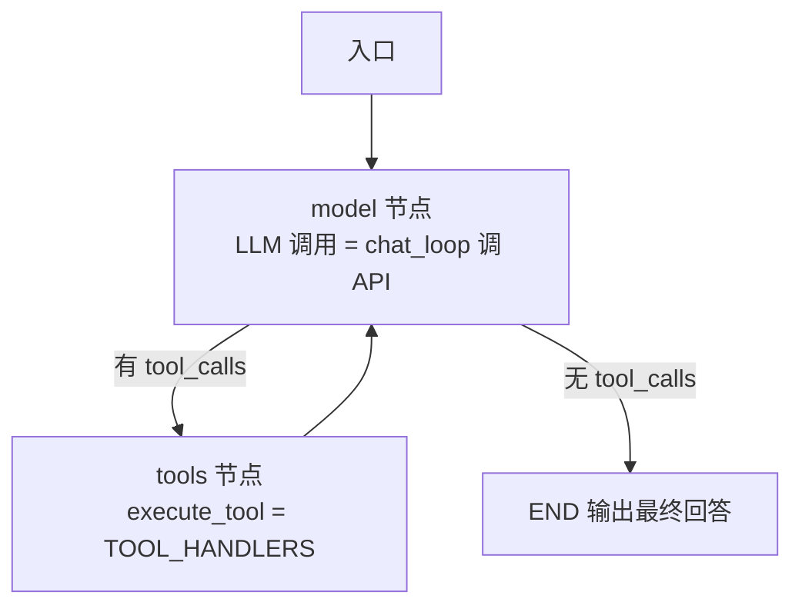

# 技术总监 × Agent 开发双轨培训｜第 2 周学习资料

- 周期：2026-10-19 起（W2）
- 主题：LLM 应用工程 · 模型选型 · Agent 框架全景 · LangChain/LangGraph 引入 · P1 实操
- 配套：P1 代码仓库 projects/p1/（已 push，HEAD d314b41）

## 1 本周概览

| 已完成事项 | 结果 |
| --- | --- |
| 课时 1：LLM 应用工程（消息协议 / system 规范 / 函数调用） | 完成 |
| 课时 1 实操：P1 最小 demo + A6 生产级评审 | 3 项必改全部应用，断言待补 |
| 课时 2：LLM 原理速通与模型选型 | 完成 |
| 课时 3：Agent 框架全景 + LangChain/LangGraph 引入 | 完成（先学框架，再代码实操） |
| Git 仓库首次 push | 完成（PAT 凭据） |

学习顺序建议：先通读本资料建立框架认知，再动手做第 8 节的多工具扩展实操。

## 2 课时 1｜LLM 应用工程

### 2.1 Chat Messages 协议

所有 LLM 应用的地基。消息只有三种角色，不要自创：

| 角色 | 放什么 | 原则 |
| --- | --- | --- |
| system | 角色设定、规则、输出格式约束、few-shot 示例 | 放稳定不变的 |
| user | 任务、输入数据、上下文 | 放每次变化的 |
| assistant | 历史回答（多轮对话的上下文） | 代码里用列表累积 |

### 2.2 system 的定位与理由

定位：完整模型输入 = messages 数组（system ＋ 历史 ＋ 当前 user）＋ 工具定义 ＋ 采样参数。system 是其中优先级最高、常驻不变的一环，日常口语中的“Prompt”最标准的承载位就是 system prompt；动态渲染、上下文构建都挂在这一环。

| 组别 | 条目 | 一句话说明 |
| --- | --- | --- |
| ① 优先级 | 指令层级 | 模型按 system > user > 外部内容顺序遵循，system 权重最高 |
|  | 抗覆盖 | 用户后说“忽略之前的指令”，system 里的规则最难被撬动 |
| ② 稳定性 | 抗截断 | 长对话摘要/截断只压缩 user 历史，system 模板永远在 |
|  | 会话独立 | 新会话、清历史都不丢，且所有会话共享同一套规则 |
|  | 多轮一致 | 每轮规则相同且生效，不依赖“历史恰好没被删” |
| ③ 安全性 | 结构隔离 | user/tool 层可能混入外部内容，system 与它们分层，缩小注入面 |
|  | 内容边界 | 安全与合规约束放 system 更稳（非绝对免疫，但攻击面小得多） |
| ④ 工程性 | 职责分离 | 稳定规则与每次变化的任务输入分开，改规则只改一处 |
|  | 可测试 | A/B 版本与回归时固定 system 只换 user |
|  | 框架配合 | LangChain/LangGraph 把 system 当一等角色，动态注入挂在这一层 |

纠错记录（重要）：system 并不省 token——它随每次请求重发，与“放第一轮 user”（靠历史重发）token 占用相同。真正的 token 浪费是把规则重复写进每一条 user 消息（N 轮即 N 份拷贝）。省 token 靠四条：system 内容精简、长历史截断/摘要、few-shot 压缩、动态 system 只注入本次所需。结论：“放哪”解决优先级与稳定性，不解决成本。

### 2.3 八段式标准结构与写作六原则

| 段位 | 内容 | 要点 |
| --- | --- | --- |
| ① | 身份与目标 | 你是谁、服务谁、一句话任务目标（优先级最高，放最前） |
| ② | 输入协议 | 会收到什么结构；缺信息时先问还是先猜 |
| ③ | 输出规范 | 格式（JSON/Markdown）、字段、长度、语言 |
| ④ | 执行规则 | 优先做什么、禁止做什么（附替代行为）、安全边界 |
| ⑤ | 工具使用 | 有哪些工具 {tools}、何时调哪个、失败怎么办 |
| ⑥ | 上下文使用 | 用检索资料回答并标注来源；未知就明说，不编造 |
| ⑦ | 质量自检 | 输出前过 2—3 条检查项，不达标先修正（A5 雏形） |
| ⑧ | 示例（可选） | 1—3 个输入→输出对，放最后或独立 few-shot 块 |

写作六原则：

| 原则 | 反例 → 正例 |
| --- | --- |
| 肯定句，否定给替代行为 | “不要乱编数据” → “数据必须来自检索结果；未知则回复暂未找到” |
| 具体可检验，不用抽象词 | “输出高质量分析” → “给出 3 个论点，每个带数据来源” |
| 按优先级排序 | 角色/目标最前，示例最后 |
| 只放稳定内容，动态留占位 | 写 {tools} {context} {time}，渲染时注入 |
| 当成配置管理 | 一个版本、可 A/B、进 Git |
| 长度克制 | system 只装必须的，可省略内容移进 user |

### 2.4 函数调用（Tool Calling）

四步闭环：

| 步骤 | 动作 | 要点 |
| --- | --- | --- |
| ① | 定义工具 | name ＋ description（何时该用）＋ 参数 JSON Schema |
| ② | 发给模型 | 用户提问 ＋ 工具清单 → 模型判断是否需要工具 |
| ③ | 返回调用请求 | 结构化 JSON：工具名 ＋ 参数 |
| ④ | 代码执行并回填 | 真实执行函数，结果作为 tool 消息返回 → 模型生成最终回答 |

三个关键点：其一，description 写清“什么情况下用”，模型靠它做工具选择；其二，参数 schema 必须严格 JSON；其三，模型永远不真正执行代码——执行权在你的程序，这是 Agent 安全边界的第一课。闭环中若工具失败，把错误信息回填给模型，让它修正参数重试，这正是纠错机制。

## 3 课时 1 实操｜P1 与 A6 生产级标准

### 3.1 P1 验收标准

| 验收项 | 标准 |
| --- | --- |
| 闭环轨迹 | 提问后终端出现：工具调用 → 执行结果 → 回填 → 最终回答四步 |
| 正常分支 | 600000 → “浦发银行今日上涨 1.25%” |
| 未收录分支 | 123456 → 如实告知未收录 |
| 拒绝逻辑 | 问天气 → 礼貌拒绝（system 执行规则生效） |

### 3.2 生产级 3 必改 ＋ 2 加分（评审结果）

| 项目 | 问题 | 修复方式 | 状态 |
| --- | --- | --- | --- |
| ① 工具执行零防御 | 模型传参不规范，缺 key/非法 JSON 直接崩 | 注册表 ＋ try/except 容错，错误回填给模型重试 | 已应用 |
| ② 参数校验 | 股票代码未校验 | get_stock_change 入口校验 6 位数字 | 已应用 |
| ③ API 异常处理 | 网络/限流/鉴权失败直接崩 | try/except 包裹请求，设 timeout | 已应用 |
| ④ 测试断言 | 纯函数未测 | 2 个 assert 覆盖正常/非法分支 | 待补 |
| ⑤ README | 仅一句话 | 补环境要求、安装、运行命令 | 已应用 |

### 3.3 关键代码片段（生产级补丁版）

工具注册表与容错（Skill 抽象的雏形：加工具只加一行）：

```python
TOOL_HANDLERS = {'get_stock_change': get_stock_change}

def execute_tool(name: str, arguments: str) -> dict:
    handler = TOOL_HANDLERS.get(name)
    if not handler:
        return {'error': 'unknown tool: ' + name}
    try:
        args = json.loads(arguments)
        return handler(**args)
    except (json.JSONDecodeError, TypeError, KeyError) as e:
        return {'error': 'bad arguments: ' + str(e)}
```

参数校验与 API 异常处理（片段）：

```python
def get_stock_change(code: str) -> dict:
    if not (isinstance(code, str) and code.isdigit() and len(code) == 6):
        return {'code': str(code), 'found': False, 'message': '股票代码应为6位数字'}
    ...

try:
    resp = client.chat.completions.create(
        model=os.getenv('MODEL', 'deepseek-flash'), messages=messages,
        tools=TOOLS, timeout=30)
except Exception as e:
    print('[API error]', e, '(retry with backoff in production)')
    return
```

完整可运行版本见附录 B。

## 4 课时 2｜LLM 原理速通与模型选型

### 4.1 原理速通（一张图看懂）

```
文本 → Token 化 → Embedding → Transformer 注意力 → 预训练（预测下一个 token）
→ 指令微调 SFT → 对齐（RLHF）→ 推理时按采样参数生成
```

**一句话记住它**：LLM = 一个被训练成“会按指令补全文本”的超大自动补全器。它不查数据库、不真正“理解”，它做的是：根据上文，预测最可能的下一个词，不断重复直到输出结束。

七环节逐个拆：

| 环节 | 是什么（本质） | 和你写代码的关系 |
| --- | --- | --- |
| ① Token 化 | 文本切成子词单元，每个映射成数字 ID。中文 1 字≈1—2 token，英文 1 词≈1—2 token | **计费与上下文单位**。估算：1000 中文字 ≈ 1000—2000 token；max_tokens 也是这个单位 |
| ② Embedding | 每个 token ID 对应一个高维向量（几百到几千维）。**语义相近的词，向量距离近** | RAG 检索的本质：问题与文档都转成向量，按余弦相似度找相关段落（W4 学）。Embedding 模型与对话模型是两个不同的模型/API |
| ③ 注意力 | 每个 token 生成时“扫视”上下文所有 token，按权重决定参考谁；位置编码记住顺序 | **上下文窗口的物理来源**。超过窗口（如 128K/1M）就截断；长文档质量下降，根源是注意力被稀释 |
| ④ 预训练 | 在互联网海量文本上做“预测下一个 token”，学到语言规律、隐含知识与推理模式 | 你不接触它，拿到的是成品 API。这也是**幻觉源头**：模型在编“最可能的词”，不是查库 |
| ⑤ 指令微调 SFT | 用海量“指令—正确答案”对，把模型从“补全文本”训练成“听从指令”，学会格式与步骤 | **system prompt 有效的底层原因**——“服从”是被训练出来的；八段式对齐了模型被训练时的输入格式 |
| ⑥ 对齐 RLHF | 人类打分/排序反馈，强化“有用、诚实、无害”，学会拒绝越权请求 | 安全边界与 P1 的“拒绝逻辑”来自这里；但你的业务规则仍要写进 system，因为对齐是通用的，你的规则是特定的 |
| ⑦ 推理采样 | 模型输出的其实是“下一个 token 的概率分布”，按策略选词（贪心或采样）直到停止符 | 工具/代码任务设 temperature=0 求确定；创作设 0.7—0.9。详见 4.2 |

**你真正要管的两端**：输入端（消息协议 system/user/assistant ＋ 工具定义 ＋ 采样参数——你写）和输出端（文本或结构化 JSON → 校验 → 回填/重试，即 A5 纠错闭环——你处理）。中间 ①—⑥ 全在服务商手里，你不用碰——但必须理解，否则排错、选型、面试都讲不清。

**三个最容易踩的认知坑**：

1. **“模型会查资料”是错觉**——它只会“补全最可能的词”，幻觉 = 它自信地补了一段不存在的事实。所以生产代码必须有“工具/检索结果回填 + 校验”，不能裸信任模型输出（这就是 P1 生产级修复的意义）。
2. **“上下文越大越好”是错觉**——窗口大 ≠ 用得好，注意力会被稀释，中间内容常被“扫一眼”忽略（lost in the middle，见 4.4 Q3）。所以才有上下文工程（W3 课时）：该省的省、关键信息放开头或结尾。
3. **“对话能力是天生的”是错觉**——预训练只让它会“补全”，会“回答问题”是 ⑤⑥ 两个阶段练出来的。这解释了为什么 system 指令、输出格式约束必须写得像“训练时的输入格式”才最有效。

### 4.2 采样参数 6 件套（必吃透）

**核心机制**：模型每一步输出的是“每个候选 token 的得分（logits）→ softmax 变成概率”，采样参数就是“从这个分布里怎么选词”的策略。

**temperature 如何改变分布（核心图，务必记形状）**：温度越低，最高概率 token 的优势被放大（分布变尖 → 输出确定、可复现）；温度越高，分布变平（低概率词也有机会被选中 → 发散、有惊喜也有胡说）。同一分布下：T=0.3 时最高候选概率约 0.92（几乎确定），T=1.0 约 0.50，T=1.5 约 0.39（明显拉平）。

参数逐个拆：

| 参数 | 机制（本质） | 怎么用 | 深坑 |
| --- | --- | --- | --- |
| token | 计费与上下文的基本单位，中文 1 字≈1—2 token | 估成本、算上下文够不够 | 别按英文习惯估算中文 |
| temperature | 缩放 logits：`logits / T` 后再转概率。T→0 趋近贪心，T 越大越随机 | 工具/代码/JSON：**0—0.2**；问答摘要：0.3—0.5；创作发散：0.7—0.9 | 以为 T=0 就绝对确定——实际仍有极小随机性；别和 top_p 同时猛调 |
| top_p | 核采样：从最高概率 token 累加，直到累计达 p（如 0.9），**只在这个“核”里采样**，长尾被裁掉 | 默认不动（或固定 0.9）；想防胡说又不失灵活时调它 | 和 temperature 作用重叠，官方建议“调一个为主”；p 太小会裁掉合理候选 |
| max_tokens | 本次生成的**上限**（不是目标）——模型可能提前遇到停止符就结束 | 按任务输出上限 × 1.2—1.3 留余量；中文 1000 字 ≈ 1000—2000 token | 设太小 → JSON 被切断/分析写一半，静默截断不报错，最阴的坑 |
| JSON mode | 服务商用约束解码**强制输出合法 JSON**（不靠模型自觉） | `response_format={"type":"json_object"}`；prompt 里仍要描述结构 | **只保证“合法”，不保证“符合你的 schema”**——字段名、类型靠 prompt + 代码校验兜底 |
| 函数调用 | 结构化工具请求（课时 1 已用）：模型返回的不是文本而是结构化工具请求 | 适合“要执行动作”的场景；JSON mode 适合“只要结构化数据”的场景 | 两者不是替代关系 |
| streaming（生产高频） | 增量返回 token 流，边生成边出字 | 交互场景必开（首字延迟大幅下降）；流式时 max_tokens/temperature 照常生效 | 流式返回是增量片段，需要自己拼接；错误处理要看“流中途断”分支 |

参数组合速查表（直接抄）：

| 任务类型 | temperature | top_p | max_tokens |
| --- | --- | --- | --- |
| 工具调用 / 代码生成 / JSON 输出 | 0—0.2 | 1（不动） | 按输出上限留 30% |
| 知识问答 / 摘要 | 0.3—0.5 | 0.9 | 按篇幅留余量 |
| 翻译（忠实为主） | 0.3 | 0.9 | 原文 ×1.3 |
| 创作 / 头脑风暴 / 角色对话 | 0.7—0.9 | 0.9—1 | 放得宽一些 |

一句话记忆：**temperature 改“形状”，top_p 做“裁剪”，max_tokens 防“截断”，JSON mode 只保“合法”。**

### 4.3 模型选型矩阵

**选型的本质**：不是选“最强”，是选“匹配”——**任务匹配 × 成本可承受 × 可替换性** 三者取交集。面试题“你怎么选模型”的满分答案是工程决策，不是打榜。

**DeepSeek 官方家族（截至 2026-10）**：

| 模型 | 定位 | 上下文 | 思考模式 | 适用 |
| --- | --- | --- | --- | --- |
| V4-Flash（当前用） | 快捷经济；推理能力接近 Pro，世界知识稍逊 | 1M | 支持（默认思考，可切非思考） | 高频工具调用、Agent 循环、批量任务 |
| V4-Pro | 知识储备最强 | 1M | 支持 | 复杂长文分析、高难度推理 |
| V4.1-Flash-1017（10-17 新） | Flash 升级：更快更便宜、基准上涨 | 1M | 支持 | Flash 最新档 |
| 旧 deepseek-chat / deepseek-reasoner（V3.2） | 通用 / 思考 | 128K | — | 兼容旧接口时用 |

新增能力（对 Agent 重要）：官方 **Search / Fetch 接口**（5 元/千次），“提问—找资料—读原文—执行”链路可原生搭建——W3 上下文工程会用到。

五维度选型矩阵：

| 维度 | 判断方法 | 你的场景结论 |
| --- | --- | --- |
| 函数调用能力 | 拿真实工具任务测：参数是否规范、会不会乱造参数、多工具时会不会选错 | V4-Flash 在 Agent 测评表现好，P1/P2 用它没问题 |
| 推理 vs 通用 | 需要长思维链（数学/代码推导/复杂规划）→ 思考模式；低延迟高频 → 非思考 | 工具调用默认**非思考**（快）；复杂规划任务临时切思考 |
| 上下文长度 | 短任务 8K 够；RAG 32K+；长文档 1M 档 | 1M 是“装得下”的上限，实际 32K—128K 足够 |
| 成本/速度 | token 单价 × 用量；延迟敏感度 | Flash 就是为“高频低价”设计的，首选 |
| 中文与生态 | 指令跟随质量、工具生态、OpenAI 兼容性 | DeepSeek API 兼容 OpenAI 格式，P1 代码零改动 |

选型检查单（5 步，直接抄）：

1. **定任务类型**：工具调用 / RAG / 长文分析 / 创作——任务决定主维度（工具任务先看函数调用能力）；
2. **测函数调用**：拿 3 个真实工具用例打一遍——参数规范？乱造参数？多工具选错？不通过就换档；
3. **定上下文与模式**：估最大输入长度 → 选够用的窗口（不是越大越好）；低延迟场景切非思考模式；
4. **算成本**：token 单价 × 日均调用量 × 输入/输出比，超预算就降档或压缩输入（上下文工程）；
5. **封装可替换**：模型名进 .env、走 OpenAI 兼容层，任何时刻可换档不换代码（P1 已做到）。

面试口径（背这句）：“选型看三件事：任务对函数调用和推理的要求、单位成本与延迟、以及模型可否替换。我不会赌单模型——模型名写进配置，走统一接口，任何时刻能换。”

**模型名确认**：`deepseek-flash` 为 DeepSeek 官方模型名（V4-Flash 档），本仓库 `MODEL` 环境变量统一使用 `deepseek-flash`。

### 4.4 单元 1 检验题与参考答案

**Q1：LLM 凭什么能做到“回答问题”而不是只会续写句子？**

参考答案：三个阶段叠加。预训练（预测下一个 token）让模型获得语言能力与知识，但只会“补全”；指令微调 SFT 用海量“指令—答案”对把它训练成“按指令回答”，学会服从与输出格式；对齐 RLHF 用人类偏好反馈强化“有用、诚实、无害”。三者缺一，都不构成你看到的对话能力。

**Q2：Embedding 为什么能用于检索？RAG 找相关文档靠什么计算？**

参考答案：Embedding 把文本映射为高维向量，语义相近的文本其向量距离近（相似度高）。检索时把用户问题与文档片段都转成向量，按向量相似度（最常用余弦相似度）找最相关的片段。线上检索通常是“向量召回 + 重排”两段式。

**Q3：为什么模型在长对话/长文档里质量会下降？**

参考答案：至少两点。① 上下文窗口有限（如 128K），超出即截断，导致语义不全；② 注意力机制在长上下文中被摊薄，每个 token 能“扫视”的权重被稀释，中间位置的信息最容易被忽略（lost in the middle）——即使没截断，也是两头保留好、中间被“扫一眼”。这决定了上下文工程的关键信息要放开头或结尾。

追问：为什么中间位置最容易被忽略？（三个机制叠加）

1. **注意力沉淀（attention sink）**：模型把不成比例的注意力分给少数特殊 token（尤其开头 token），中间 token 的注意力被挤占；
2. **位置编码的距离衰减**：RoPE 等相对位置编码会弱化远距离关联，中间内容既非最近也无结构地位；
3. **训练数据先验**：语料里摘要/结论/标题常在文档两头，模型学成“重要信息在两头”的偏见。

位置编码的角色要分两层：它主要决定“能支持多长”（外推能力，RoPE/ALiBi 相对位置编码优于旧式绝对编码）；对 lost in the middle 只贡献“距离衰减”一环——attention sink 与训练先验同样是主因。**上下文“装得下”靠位置编码，“用得好”靠注意力分配。**

出处：Liu et al. 2023《Lost in the Middle: How Language Models Use Long Contexts》（U 形曲线实验）；Xiao et al. 2023《Efficient Streaming Language Models with Attention Sinks》（Meta AI）。

### 4.5 单元 2 检验题与参考答案

**Q1：为什么工具调用和 JSON 任务要把 temperature 设很低（0—0.2）？结合“幻觉”讲。**

参考答案：低温度让概率分布更尖锐集中，模型倾向选“最可能”的词，输出稳定可复现，减少发散型幻觉（随机乱编）。但要记住：低温度**不能消除自信型幻觉**——模型对不存在的知识照样高置信输出（预训练先验）。所以工具/JSON 任务必须是“低温度 + 工具结果回填 + 校验兜底”三件套：低温度管随机性，回填管事实，校验管结构（P1 的参数校验就是例子）。

**Q2：temperature 和 top_p 都能控制随机性，机制上有什么本质区别？**

参考答案：temperature 是**改形状**——先除 T 再 softmax，整体缩放全部候选的概率分布（低→尖、高→平）；top_p 是**做裁剪**——从最高概率词开始累加，保留累计概率达 p 的“核”，只在核内采样，长尾低概率词被裁掉。两者效果重叠，官方建议调一个为主（T=0 时 top_p 已无意义，贪心不做采样）。

**Q3：设了 JSON mode，为什么拿到的 JSON 还可能不是你想要的？该由谁兜底？**

参考答案：JSON mode 用约束解码保证“合法 JSON”，但不保证“符合你的 schema”——字段可能缺、类型可能错、值可能不合业务规则。兜底分两层：① 解析层：json.loads 失败则重试/报错；② 业务层：schema 校验（字段齐全、类型正确、值合法，如 Pydantic）。程序兜底是最后防线，与低温度互补——低温度管“不乱编”，程序管“不合规”。

### 4.6 单元 3 检验题与参考答案

**Q1：你的 deepseek-flash 适合哪些任务？什么情况下要升到 Pro 或切思考模式？**

参考答案：flash 定位是“快捷经济、推理接近 Pro、知识储备稍逊”。适合高频工具调用、Agent 循环、一般问答等“少量推理”任务。升级判断拆成两个维度：**难度高 → 切思考模式**（同一模型，深度推理）；**知识密集 → 升 Pro**（需要更广更准的世界知识）。工具调用/Agent 高频循环默认 flash 非思考，兼顾速度与成本。

**Q2：选型为什么不能只盯“模型强不强”？至少说两个其他维度。**

参考答案：选型是工程决策，三要素缺一不可：① 任务匹配（函数调用能力、推理需求、上下文长度是否满足任务）；② 成本可承受（token 单价 × 用量，含延迟/效率）；③ 可替换性（模型名进配置、走统一接口，不锁死单模型）。只盯“强”会选到贵、慢、不必要的模型，且架构被单模型绑架。

**追问扩展：可替换性详解（面试高频）**

可替换性 = 换模型不换代码，靠三层实现：① 配置层——模型名/base_url 进 .env；② 接口层——统一 OpenAI 兼容格式（chat + tools + streaming）；③ 契约层——工具定义标准 JSON Schema、输出结构化 + schema 校验，不依赖模型特有字段。

为什么值钱：模型迭代快，不锁死供应商；成本/性能可动态调整；规避限流、涨价、下线、合规风险；换模型后有评测依据。

面试典型追问与答法：

- “你做过模型切换吗？怎么保证质量？”→ 改配置 + 跑回归用例（同一批测试在两个模型上各过一遍）；
- “不同模型输出不一样怎么办？”→ 结构化输出 + 校验层抹平差异 + 失败重试；
- “OpenAI 兼容层够用吗？”→ 覆盖 chat/tools/streaming；但模型特有能力（如 DeepSeek 思考模式、reasoning_content 字段）兼容层不覆盖，要适配层或降级逻辑；
- “可替换 ≠ 等价，怎么选？”→ 换模型必评测，不过就换回或适配；
- “可替换性的成本？”→ 抽象层维护 + 兼容测试；过度抽象拖慢开发——面向接口编程讲究“度”。

P1 已具备雏形：MODEL 在 .env、OpenAI 兼容 base_url、TOOL_HANDLERS 注册表——换任意 OpenAI 兼容服务商，改两行配置即可。

**Q3：思考模式 vs 非思考模式，工具调用场景怎么选？为什么？**

参考答案：**默认非思考**。工具调用追求低延迟、高确定性、结构稳定，思考模式“想太多”会拉高延迟与 token 成本；工具场景的“难”通常靠任务拆解 + 多次工具调用 + 校验兜底解决，而不是靠单次深度思考。例外：确需长思维链的复杂规划、代码推导步骤，临时对单次请求切思考模式。生产 Agent 里思考模式是例外不是常态，可做难易分级路由。

### 4.7 单元 4 检验题与参考答案

**Q1：三条分类轴是什么？为什么“编排哲学轴”最重要？**

参考答案：三条轴 = ① 形态轴（库 vs 平台：写代码 vs 拖拽）；② 编排哲学轴（框架的核心思想：图状态机 / 角色协作 / 对话多 Agent / 函数调用中心 / 类型安全 / 数据 RAG 中心）；③ 协议轴（MCP 工具互操作 + A2A Agent 通信）。

为什么编排哲学最重要：编排 = 把问题分解成步骤、在 Agent/工具/人之间流转的状态与决策方式——这是框架的架构思想，决定它适合什么任务；形态（库/平台）只是使用方式，协议（MCP/A2A）只是互操作标准，都不改变编排思想。选框架本质是选“它怎么帮你分解问题并解决问题”。

**Q2：三个场景各选什么框架？一句话理由。**

参考答案：① 长任务/审批流 → LangGraph：图状态机 + 状态持久化（checkpointer），可暂停、可审计、可恢复；② 多角色快速原型 → CrewAI：角色声明式，几十行搭团队；③ 快速出货且不介意绑定 → OpenAI Agents SDK：官方轻量，Handoffs 交接开箱即用。

助记：审批要“状态可审计”→ LangGraph；原型要“快”→ CrewAI；出货要“轻”→ Agents SDK。

**Q3：2026 年选框架的“硬门槛”是什么？为什么？**

参考答案：MCP 与 A2A。MCP（Model Context Protocol）= 模型调用外部工具/数据源的开放协议，工具以 MCP Server 一次编写、处处可用，打破“每框架一套工具接口”；A2A（Agent2Agent）= Agent 间互操作协议，不同厂商/框架的 Agent 能互相发现与协作。为什么是硬门槛：2026 生态工具与 Agent 都走向标准化接入，框架不支持 MCP 意味着工具/Agent 被锁在单框架内——可替换性从“模型层”（单元 3）提升到“工具层/Agent 层”（协议层）。一句话：MCP 管“Agent 用工具”，A2A 管“Agent 找 Agent”。

### 4.8 单元 5 检验题与参考答案

**Q1：为什么长任务/审批流必须选 LangGraph？根因是什么？**

参考答案：根因是**显式状态 + 持久化**。状态是“一等公民”（每个节点读写同一份 State），checkpointer 每步落盘（内存/SQLite/Postgres）→ 崩溃可恢复、历史可回放、过程可审计；Agents SDK / CrewAI 状态在模型上下文里隐式流转，简单但不可审计、不可恢复。长任务要“可恢复 + 可审计”，所以选 LangGraph。

**Q2：三个框架的状态管理差在哪？对“可审计”意味着什么？**

参考答案：LangGraph 显式 + 持久化（State 对象 + checkpointer），每步状态变更可追溯、可回放；Agents SDK / CrewAI 状态隐式（模型上下文自管），简单但不可审计、不可恢复。可审计 = 每一步输入/输出/状态变更都可记录、可回放、可追溯（配合 LangSmith 的 trace：token 成本、耗时），而不只是“能监控”——审计偏“事后可追溯 + 中途可恢复”，监控偏“运行时可观察”。

**Q3：面试官问“审批流怎么实现人审”，你答什么关键词？**

参考答案：框架级关键词是 **interrupt（节点级暂停）+ resume（恢复）+ checkpointer（状态保留）**——节点内 interrupt() 暂停，状态已落盘，人批准后 Command(resume=...) 从暂停点继续，即“机器停、人等签、恢复续跑”。Dify 等低代码平台也能做产品级人审，但那是另一条路（平台方案）；面试语境考的是 LangGraph 的原生机制。

### 4.9 单元 6（LangGraph 入门）检验题与参考答案

**Q1：LangGraph 的 State 为什么是“唯一事实来源”？节点之间怎么传递数据？**

参考答案：**节点之间不是通过“边”传数据，而是通过 State 传数据**。边只决定“流向”（谁接谁、走哪条路），不搬运数据；节点 A 更新 State 字段 → 节点 B 从 State 读取。State 是贯穿全程的唯一数据容器（唯一事实来源），所有节点读写它，因此任意节点都能拿到完整上下文，审计也以它为准。这是 LangGraph 区别于“参数管线”的核心思想：**边管流程，State 管数据**。

**Q2：条件边（tools_condition）解决什么问题？在 P1 里对应哪句判断？**

参考答案：条件边是**路由决策**——根据当前 State（LLM 返回的消息里有没有 tool_calls）决定下一步走哪个分支：有工具调用 → 走 tools 节点；没有 → 直接到 END。它不是“筛选工具”，而是“决定下一步去哪”；是 Agent 分支与循环扩展的开关，让 Agent 能处理多步复杂问题。P1 里对应 `if 消息里有 tool_calls:` 的判断（有则执行工具、回填、再问；无则直接回答退出）。

**Q3：checkpointer 是什么？什么时候必须传？**

参考答案：checkpointer 是**状态快照持久化器**——每次图执行推进（super-step）后，把完整的 State 快照写入外部存储（内存 MemorySaver / SQLite / Postgres）。三个核心价值：① 崩溃恢复（长任务进程挂掉后从最近快照续跑，不重头来）；② 时间旅行/回放（按 thread_id 取任意历史状态做审计）；③ 人审恢复（interrupt 暂停后状态不丢，Command(resume=...) 从暂停点继续）。必须传的场景：审批流/人审（interrupt 依赖它保留状态）、长任务要断点续跑、要审计回放。不传时图是“一次性执行”，跑完状态即丢，中断无法恢复。

### 4.10 单元 6 检验题与参考答案

**Q1：什么时候“别用框架”？为什么框架在简单任务上是负资产？**

参考答案：判据是**流程复杂度而非调用频率**：单次问答、线性流水线、工具少且固定、无状态恢复/审计需求 → 不用框架。偶发但流程复杂（多步 + 人审）仍值得用框架（保证正确性与审计）；偶发且线性则直接调 API。负资产逻辑：框架的学习曲线 + 调试成本 + 依赖体积，在简单任务上没有对应收益——收益为零，成本为正。

**Q2：你的决策顺序？**

参考答案（两层组织，都成立）：

- 规则版（8 条）：① 长任务/人审/审计 → LangGraph；② 单 Agent 出货 → Agents SDK；③ 多角色 → CrewAI / MS Agent Framework；④ 强类型 → PydanticAI；⑤ RAG → LlamaIndex；⑥ 企业集成 → Semantic Kernel；⑦ 非工程团队 → Dify / Coze；⑧ PoC → smolagents；
- 高层版（技术总监视角）：先看任务类型（选大方向框架）→ 再看快速验证还是成熟产品（原型档：CrewAI / smolagents；生产档：LangGraph / MS Agent）→ 最后看团队形态要不要低代码平台化（Dify / Coze）。面试先讲 8 条，再补一句“我还会叠加成熟度与团队形态两个维度”。

**Q2 详解：每一问的深层逻辑（为什么是这个顺序）**

排序原则：第一问的返工成本最高（选错框架 = 重写架构），所以最先问。

1. **第一问（长任务/人审/审计）是“是不是 Agent 问题”的本质判断**：任务是否需要循环决策、多步工具链、状态跨步骤保留、人介入。三个子问题：① 要查多个数据源再综合？② 中间结果要给谁看/谁批？③ 跑一半挂了能否重来？任一为是 → LangGraph——它是唯一“显式状态 + 持久化 + 人审原生”的框架，这是别人做不到（或要自己造）的差异化能力；
2. **第二问（单 Agent 出货）**：不需要复杂状态，但需要“循环 + 工具”→ OpenAI Agents SDK：官方轻量、Handoffs 交接、Guardrails 护栏，MVP 最快；代价是生态绑定（呼应可替换性）；
3. **第三问（多角色）**：任务天然按角色拆（研究/写作/审查）→ 原型 CrewAI（声明式几十行），生产 MS Agent Framework（Agent 间发消息）；
4. **第四问（强类型）**：团队 FastAPI/Pydantic 风格、要输出即校验、编译期抓错 → PydanticAI——金融/结构化输出场景尤其合适；
5. **第五问（RAG）**：知识库问答/文档 Agent → LlamaIndex（检索管线成熟，W4—W5 正式学）；
6. **第六问（企业集成）**：现有系统插件化、语言中立 → Semantic Kernel；
7. **第七问（非工程团队）**：Dify / Coze 低代码平台；
8. **第八问（PoC/教学）**：smolagents 极简。

叠加两个维度变成**决策面**（高层版落地）：

- 成熟度：原型要“快”（CrewAI / smolagents），生产要“稳”（LangGraph / MS Agent）；
- 团队形态：工程团队选库（可控可审计），非工程团队选平台（Dify / Coze）；
- 结论：8 条规则是“能力需求”纵轴，成熟度 × 团队形态是横轴——选型 = 在 2D 决策面上定位，不是查表。

**Q3：面试官问“框架怎么选”，你的回答骨架？**

参考答案：四步：① 先问需求三件事（任务类型 / 成熟度 / 团队形态）；② 落到具体框架（审批多 → LangGraph interrupt 原生；多角色 → CrewAI；出货 → Agents SDK；非工程 → Dify）；③ 强调“简单任务不用框架”；④ 给一个自己做过/学习过的例子闭环。注意：Dify 与 LangGraph 是两条路（平台 vs 库）——技术团队自研审批流用 LangGraph，非工程团队才上 Dify，面试分清。

**Q3 详解：完整话术示例（可直接背）**

面试官问：“你项目里的 Agent 框架怎么选的？/ 你了解哪些 Agent 框架？”

话术：

“我选框架是需求驱动的，不跟热度，分三步。
第一步，先判断任务形态——有没有循环决策、多步工具链、人审或审计要求。有，就直接上 LangGraph，因为显式状态 + checkpointer 保证可审计、可恢复，interrupt 原生支持审批流；没有，就降级到更轻的方案。
第二步，看交付目标——快速验证还是生产级。原型我会选 CrewAI 或 smolagents，声明式几十行搭出多角色；生产级再看团队形态：工程团队自研用 LangGraph / PydanticAI（强类型、输出即校验），非工程团队上 Dify 拖拽。
第三步，我还会明确什么时候不用框架——单次问答、线性流水线直接调 API，框架在简单任务上是负资产。
举个例子：我之前做的 P1 工具调用 Agent，先手写循环验证逻辑，等要加多步工具链和审计时，才图化成 LangGraph。”

要点：每句都带“为什么”（讲逻辑，技术总监风）；用自己做过/学过的例子闭环。

面试追问防御链：

| 追问 | 接法 |
| --- | --- |
| “LangGraph 和 CrewAI 区别？” | 状态管理与灵活性：显式状态/人审/可观测 vs 声明式快、复杂分支弱（5.2 六行对比） |
| “怎么验证选对了？” | 回归用例 + 评测门：同一批工具调用/JSON 契约用例，两个框架各跑一遍 |
| “MCP 呢？” | 协议层：工具一次编写处处可用，框架对 MCP 的支持是硬门槛（单元 4） |
| “框架迭代快怎么跟？” | 关注官方 changelog + 抽象层隔离框架（呼应可替换性） |

### 4.11 单元 7 检验题与参考答案

**Q1：bind_tools 自动做了什么？P1 里对应哪段手工代码？**

参考答案：bind_tools 从**函数签名自动生成 JSON Schema** 并绑定到 LLM：函数名 → tool 的 name、docstring → description、类型注解与默认值 → parameters（参数结构）。让模型知道“有哪些工具、每个工具怎么传参”。P1 里对应手工写的 12 行 `TOOLS = [{...}]` dict（type/function/name/description/parameters/required）——bind_tools 把它变成一行。注意：它只负责“告诉模型”，**不负责执行**——执行仍靠 TOOL_HANDLERS 查表（执行权在你）。

**Q2：ToolMessage(out, tool_call_id=tc['id']) 对应 P1 哪几行？tool_call_id 为什么重要？**

参考答案：对应 P1 的 `messages.append({"role":"tool","tool_call_id":tc.id,"content":json.dumps(result)})`（工具结果以 tool 角色回填）。tool_call_id 的本质是**配对机制**：模型一次回复可同时发出多个工具调用（并行，每个唯一 id），回填时必须按 id 对应回去，模型才知道“这个结果属于哪个调用”——尤其多工具并行、参数相似时，没有 id 就无法关联。它不是“用户/时刻标识”，是协议层的调用-结果配对键。同步/异步都靠它，框架不会替你配对。

**Q3：框架不帮你做的“兜底”指什么？**

参考答案：框架替你做了**参数解析**（tc['args'] 已是 dict，P1 里要自己 json.loads）；但**业务层校验与容错全要自己写**：参数值是否合法（code 是否 6 位数字）、工具执行异常（try/except）、网络/API 异常、输出是否合规。P1 的 execute_tool 容错（try/except + 回填错误让模型修正重试）就是兜底样板——“程序兜底”的落地：框架管协议，程序管正确性。

### 4.12 单元 8 检验题与参考答案

**Q1：reducer 注解是干嘛的？不写会怎样？**

参考答案：reducer 改变字段的**合并策略**——默认节点返回值会**覆盖** State 字段；`Annotated[list, 'messages']` 告诉框架“messages 要累加合并”，每次节点返回的新消息自动 append 到历史，保留完整上下文。不写的后果：节点返回 {'messages': [新消息]} 会把历史 messages 整个替换，多轮后只剩最后一轮的消息——模型看不到前面对话，上下文断裂（等价于 P1 里 messages 被重置）。

**Q2：call_tool 为什么取 state['messages'][-1]？对应 P1 哪段？**

参考答案：最后一条一定是 model 节点刚返回的 AIMessage——即**当前这轮的模型决策**（含本轮要执行的 tool_calls）。工具执行必须针对“最新决策”，不能取旧消息（可能已执行完）。对应 P1 的 `msg = resp.choices[0].message; for tc in msg.tool_calls`——resp 就是最新一轮的响应，同一逻辑：取最新、执行最新。

**Q3：should_continue 对应 P1 什么逻辑？stream 强在哪？**

参考答案：should_continue = P1 的 `if msg.tool_calls: continue（回环）/ return（结束）`——有工具请求回 tools，没有到 END。app.stream 强在**逐步 yield 每个节点的输入/输出**：能定位“哪一步出的问题”（节点级调试），看 messages 每步演进；P1 的 print 只有两行（工具调用、最终回答），靠人肉观察。stream 还支持 stream_mode（values/updates），生产可对接可观测。

## 5 课时 3｜Agent 框架全景与选型

### 5.1 主流框架地图（2026 生态）

| 框架 | 出品方 | 核心范式 | 上手难度 | 生产成熟度 | 多 Agent | 适合场景 |
| --- | --- | --- | --- | --- | --- | --- |
| LangChain | LangChain 社区 | 组件化 LLM 应用框架（400+ 集成） | 中 | 高 | 中 | 快速原型、RAG、工具链 |
| LangGraph | LangChain 社区 | 低层图编排 / 状态机 | 高 | 很高（checkpointer、人审、LangSmith） | 强 | 生产级复杂编排、长任务、审批流 |
| CrewAI | CrewAI | 角色分工式多 Agent | 低 | 中 | 强 | 快速多角色协作原型 |
| Microsoft Agent Framework | 微软 | 对话式多智能体编排（AutoGen 已进维护模式，由其继承） | 中 | 高 | 强 | 多智能体协作 |
| OpenAI Agents SDK | OpenAI | 官方轻量 SDK（Handoffs/Guardrails/Sessions） | 低 | 高 | 中 | OpenAI 生态快速出货 |
| LlamaIndex | LlamaIndex | 数据 / RAG 中心 | 中 | 高 | 中 | 知识库问答、文档 Agent |
| Pydantic AI | Pydantic 团队 | 类型安全、结构化输出（v2 已稳定） | 低-中 | 中-高 | 中 | 强类型、FastAPI 风格 |
| smolagents | HuggingFace | 极简代码执行 Agent | 低 | 中 | 中 | 教学、PoC |
| Semantic Kernel | 微软 | 企业插件化、语言中立 | 中 | 高 | 中 | 企业应用集成 |
| Dify / Coze | 开源 / 字节 | 低代码可视化平台 | 低 | 高 | 强 | 快速交付、非工程团队 |

**三条分类轴（先分类再看表，比背表值钱）**：

1. **形态轴**：库（你写代码：LangGraph / CrewAI / Agents SDK / PydanticAI / smolagents / Semantic Kernel / LlamaIndex / LangChain）vs 平台（低代码可视化：Dify / Coze）。工程团队选库，业务团队选平台；
2. **编排哲学轴**（每个框架的核心思想，最重要）：
   - 图状态机：**LangGraph**——节点 + 边 + 显式状态，可持久化、可人审、可审计，生产长任务首选；
   - 角色协作：**CrewAI**——声明式定义“角色 + 任务 + 工具”，几十行搭出多 Agent 团队；短板是复杂分支/循环弱；
   - 对话多 Agent：**Microsoft Agent Framework**——Agent 之间互相发消息协作（AutoGen 已进维护模式，由其继承）；
   - 函数调用中心：**OpenAI Agents SDK**——单 Agent 循环 + 工具 + Handoffs（交接），轻快出货，偏 OpenAI 生态；
   - 类型安全：**PydanticAI**——模型输出直接用 Pydantic 校验，FastAPI 风格，强类型团队友好；
   - 数据/RAG 中心：**LlamaIndex**——先索引检索，再谈 Agent；
   - 极简：**smolagents**——代码执行型 Agent，教学 / PoC 用；
3. **协议轴**（框架之上的标准，2026 硬门槛）：MCP（模型上下文协议，工具互操作）与 A2A（Agent 间通信）——选型先看框架对 MCP 的支持。

**2026 关键变量**：

- LangGraph 1.0 GA（2025-10），LinkedIn / Uber / Klarna / Elastic / GitLab 等生产背书 → 复杂生产编排的默认答案；
- AutoGen 进维护模式，微软推 Microsoft Agent Framework 接手；
- MCP 成为工具接入的默认协议，框架对 MCP 的支持是选型硬门槛（P4 实操会用到）。

**一句话记忆表**：

| 框架 | 一句话记忆 |
| --- | --- |
| LangGraph | 图 + 状态机，生产级编排的地基 |
| LangChain | 组件全家桶，LangGraph 的上游生态 |
| CrewAI | 角色分工，几十行搭团队 |
| Microsoft Agent Framework | Agent 之间发消息（AutoGen 继任） |
| OpenAI Agents SDK | 官方轻量，Handoffs 交接 |
| LlamaIndex | 先索引检索，再谈 Agent |
| PydanticAI | 类型安全，输出即校验 |
| smolagents | 代码执行型极简 Agent |
| Semantic Kernel | 企业插件化，语言中立 |
| Dify / Coze | 低代码平台，拖拽交付 |

**面试口径（背这句）**：“我选框架按两条：先定形态（库还是平台），再看编排哲学跟任务对不对得上——长任务/审批流选图状态机（LangGraph），多角色原型看 CrewAI，快速出货且不介意绑定选 OpenAI Agents SDK。2026 年 MCP 是默认协议，框架对 MCP 的支持是硬门槛。”

### 5.2 三足鼎立：LangGraph vs OpenAI Agents SDK vs CrewAI（面试必会）

| 维度 | LangGraph | OpenAI Agents SDK | CrewAI |
| --- | --- | --- | --- |
| 状态管理 | 显式、持久化（checkpointer：内存/SQLite/Postgres） | 隐式（模型自己管） | 隐式为主 |
| 人审介入 | 原生（节点级 pause/resume） | 需自定义 | 弱 |
| 模型绑定 | 模型无关（任意 LLM） | OpenAI 优先，厂商锁定 | 模型无关 |
| 可观测性 | LangSmith 成熟 | 内置沙箱/追踪 | 一般 |
| 上手速度 | 1—2 周 | 2—3 天 | 最快（几分钟） |
| 典型场景 | 长任务、审批流、可审计工作流 | 单 Agent 快速出货 | 多角色原型 |

**每行背后的“为什么”（面试别背表，讲逻辑）**：

1. **状态管理**：LangGraph 的状态是“一等公民”——每个节点读写同一份 State，checkpointer 落盘（内存/SQLite/Postgres），崩溃可恢复、可回放；Agents SDK / CrewAI 状态在模型上下文里隐式流转，简单但不可审计。→ 长任务选 LangGraph 的根因：**要可恢复、可审计，就要显式状态**；
2. **人审介入**：审批流必须“机器停、人等签”。LangGraph 节点级 interrupt 原生支持（暂停 → 人批 → 恢复，状态还在）；SDK 需自定义；CrewAI 弱。→ 面试问“审批流怎么办”，答“interrupt + 恢复”；
3. **模型绑定**：LangGraph / CrewAI 模型无关（OpenAI 兼容即可——呼应单元 3 可替换性）；Agents SDK 为 OpenAI 优化，工具调用协议深度绑定。→ 绑定程度直接决定可替换性；
4. **可观测性**：LangGraph + LangSmith 的 trace 是生产标配（每步输入输出、token 成本、耗时）；SDK 内置沙箱/追踪；CrewAI 一般。→ 生产排障靠 trace，这是技术总监视角的“可观测性”；
5. **上手速度**：几分钟 vs 2—3 天 vs 1—2 周——速度与能力成正比，选型就是在换这个 trade-off；
6. **典型场景一句话**：长任务要“状态 + 审计”→ LangGraph；出货要“快”→ SDK；角色原型要“表达角色”→ CrewAI。

**选型决策（从单元 4 落到这里）**：先看有没有“长任务/审批/可审计”需求 → 有则 LangGraph；再看是否不介意绑定 OpenAI → 是则 Agents SDK；否则多角色原型选 CrewAI。

**LangGraph 状态可审计原理（面试深挖）**

六件套：State → 节点 → Trace → Checkpoint → Thread → Interrupt

1. **显式 State**：State 是 TypedDict（如 {plan, approved}），所有节点读入/返回状态更新——状态是“唯一事实来源”，每步变更都有据可查；
2. **节点**：每个节点是“读 State → 计算 → 更新 State”的步骤，审计粒度 = 节点粒度；
3. **Trace（观测）**：每次执行记录该节点输入/输出、LLM 调用消息、token 成本与耗时——LangSmith 给出完整调用链；
4. **Checkpointer（持久化点）**：每步执行后把状态快照落盘（内存/SQLite/Postgres）。作用：崩溃恢复（从最近快照续跑）、回放审计（按历史取任意状态）、时间旅行（从任意 checkpoint 恢复）；
5. **Thread（会话隔离）**：thread_id 隔离不同任务，审计按 thread 查历史；
6. **Interrupt（人审）**：节点内 interrupt() 暂停执行，状态已保存；人批准后 Command(resume=...) 恢复，从暂停点继续——“机器停、人等签、恢复续跑”。

代码骨架：

```python
from langgraph.graph import StateGraph, START, END
from langgraph.checkpoint.memory import MemorySaver
from langgraph.types import interrupt

class State(TypedDict):
    plan: str
    approved: bool

def draft(state): ...        # 草拟节点
def review(state):           # 人审节点：暂停等人批
    decision = interrupt({"q": "批准该计划?", "payload": state["plan"]})
    return {"approved": decision}

g = StateGraph(State)
g.add_node("draft", draft); g.add_node("review", review)
g.add_edge(START, "draft"); g.add_edge("draft", "review"); g.add_edge("review", END)
app = g.compile(checkpointer=MemorySaver())   # 状态持久化 → 可审计的基础
# 人批准后恢复：app.invoke(Command(resume="approve"), config={"configurable":{"thread_id":"t1"}})
```

一句话：**State 给数据、Checkpoint 给快照、Trace 给记录、Thread 给隔离、Interrupt 给人审——五者合起来就是“可审计”**。

### 5.3 选型决策规则

- 要**完全控制状态流 + 生产级 + 可审计** → LangGraph（本培训主线）
- 要**最快出原型** → CrewAI / OpenAI Agents SDK
- 数据**强依赖 RAG** → LlamaIndex（W4—W5 正式学）
- 要**类型安全 + 结构化输出** → Pydantic AI
- 要**交付给非工程团队** → Dify / Coze
- 面试口径：三足鼎立对比 + “复杂生产编排选 LangGraph、快速出货选 Agents SDK、快速原型选 CrewAI”

课表衔接：主线学 LangGraph（A3 编排框架、W7 多智能体）；CrewAI 与 Agents SDK 在 W7 框架对比课时实操；LlamaIndex 在 W4—W5 RAG 阶段使用。

**决策顺序（先问需求，再选框架——面试讲这个顺序）**：

1. 第一个问题：任务需不需要**循环 / 多步 / 分支 / 人审 / 长任务 / 审计**？→ 需要 → LangGraph（状态可审计、可恢复）；
2. 只是“单 Agent + 工具”快速出货？→ OpenAI Agents SDK（或直接 OpenAI 兼容 SDK，最轻）；
3. 多角色协作？→ 原型用 CrewAI，生产用 Microsoft Agent Framework；
4. 强类型团队 / 输出即校验？→ PydanticAI；
5. 强依赖 RAG / 数据？→ LlamaIndex；
6. 企业现有系统集成？→ Semantic Kernel；
7. 非工程团队 / 要拖拽交付？→ Dify / Coze；
8. 教学 / PoC？→ smolagents。

**什么时候别用框架（直接调 API 反而更好）**：

- 单次问答 / 线性流水线（一次调用就完事）；
- 工具少且固定、无循环无分支——框架抽象成了负资产：学习曲线 + 调试 + 依赖成本；
- 对照：P1 手写版本身就是“不用框架”的正确场景——直到要加多步工具链 / 审计才值得图化。

**两个选型陷阱**：

- 陷阱 1：**为用框架而用框架**——复杂度溢价：框架的学习、调试、依赖成本在简单任务上是纯负资产；
- 陷阱 2：**只盯热度不盯匹配**——CrewAI 社区最热（49.8k star）但复杂分支弱；LangGraph 最强但上手 1—2 周。热度是生态信号，不是任务匹配。

**面试口径（背这句）**：“我的选型顺序是需求驱动：先问有没有长任务/人审/审计需求 → 有则 LangGraph；其次单 Agent 出货 → Agents SDK；多角色 → CrewAI / MS Agent Framework；强类型 → PydanticAI；数据为主 → LlamaIndex；非工程团队 → Dify/Coze。简单任务不用框架。”

## 6 课时 3｜LangChain/LangGraph 引入

**环境安装（先装包，代码层前置）**：

```bash
# 清华源加速（国内）
pip install langchain-core langchain-openai langgraph python-dotenv -i https://pypi.tuna.tsinghua.edu.cn/simple

# 验证（能跑通这行即成功）
python -c "from langchain_openai import ChatOpenAI; from langgraph.graph import StateGraph, START, END; print('OK：LangChain + LangGraph 已就绪')"
```

| 包 | 干什么 |
| --- | --- |
| langchain-core | 核心抽象（Message、bind_tools、ToolMessage 等） |
| langchain-openai | ChatOpenAI——OpenAI 兼容接口，配 DeepSeek base_url 用（**需显式安装**，不在 langchain 主包） |
| langgraph | 图编排（StateGraph / 节点 / 边 / checkpointer） |
| python-dotenv | 读 .env（P1 已在用） |

注意：P1 用的 `openai`（官方 SDK）与 `langchain-openai` 是两个包，LangChain 版需要后者。

### 6.0 LangGraph 原理与使用入门（先读这个）

**LangGraph 是什么**：LangChain 官方低层编排框架。把 Agent 流程建模成**有状态图**——节点 = 步骤、边 = 流转、State = 显式数据。相比 LangChain 的线性链，LangGraph 支持**分支、循环、条件、人审、持久化、恢复**——Agent 的本质（反复决策“要不要再调工具”）就是循环，图天然表达。

**核心概念（原理）**：

| 概念 | 是什么 | 一句话理解 |
| --- | --- | --- |
| State | 数据容器（TypedDict，如 {messages: list}） | 所有节点读写的“唯一事实来源” |
| Node（节点） | 一个函数：读 State 字段 → 计算 → 返回更新 | 一步执行单元 |
| Edge（边） | 节点间连接：普通边（顺序）/ 条件边（路由） | 决定下一步走哪 |
| 条件边 | 按函数返回值路由（如“要不要调工具”） | Agent 的决策点 |
| 循环 | 边指回前面的节点 | Agent 核心形态：LLM→工具→LLM |
| Checkpointer | 状态快照落盘（内存/SQLite/Postgres） | 崩溃恢复、回放、审计 |
| Interrupt | 节点内暂停等人/外部输入 | 审批流人审 |
| thread_id | 会话隔离键 | 每个任务的独立历史 |

**怎么使用（5 步）**：

1. 定义 State（声明字段）；
2. 写节点函数（读 State、返回字段更新）；
3. 建 StateGraph：add_node 加节点，add_edge / add_conditional_edges 加边；
4. compile()——需要持久化/人审就传 checkpointer（MemorySaver/SqliteSaver 等）；
5. invoke()——传初始 input；有线程就带 config={"configurable":{"thread_id":...}}。

**Agent 循环最小示例**（ReAct：LLM ↔ 工具）：

```python
from typing_extensions import TypedDict
from langgraph.graph import StateGraph, START, END
from langgraph.prebuilt import ToolNode, tools_condition

class AgentState(TypedDict):
    messages: list

def call_model(state):            # ① 调 LLM（带 tools 定义与消息）
    resp = llm.invoke(state["messages"])
    return {"messages": [resp]}   # ② 结果回写状态

g = StateGraph(AgentState)
g.add_node("llm", call_model)
g.add_node("tools", ToolNode([get_stock_change]))  # ③ 工具执行节点
g.add_edge(START, "llm")
g.add_conditional_edges("llm", tools_condition, {  # ④ 决策：要工具→tools，否则→END
    "tools": "tools",
    END: END,
})
g.add_edge("tools", "llm")        # ⑤ 工具结果回 LLM → 循环
app = g.compile()
result = app.invoke({"messages": [{"role": "user", "content": "查一下 600519 涨跌"}]})
```

**与你的 P1 逐行对应**（学完立刻能看懂 6.3）：

| P1 手写版 | LangGraph 版 |
| --- | --- |
| while 循环（LLM→工具→回填→再问） | 图里的 `llm → tools → llm` 环 |
| TOOL_HANDLERS 注册表 | ToolNode([...]) |
| system prompt + 消息列表 | call_model 节点内组装 |
| if 判断“要不要调工具” | tools_condition 条件边 |
| 直接回答就退出 | 条件边到 END |

**何时用、何时别用**（衔接单元 6）：

- 用：有循环 / 分支 / 人审 / 长任务 / 要审计——复杂 Agent、审批流、多步工具链；
- 别用：单次问答、线性流水线（杀鸡不用牛刀，LangChain 或直接 OpenAI SDK 更快）。

**学习路径**：概念表 → 5 步用法 → 看懂上面的例子 → 单元 9 实操：把 P1 改造成 LangGraph 版（get_usd_cny + langchain_demo.py）。

### 6.1 定位：把 P1 手写的 while 循环“图化”

P1 的 `chat_loop` 是个隐式循环：调模型 → 有 tool_calls 就执行工具 → 回填 → 再调模型。**LangGraph 就是把这段循环显式画成一张图**：节点（干活的函数）＋ 边（流转条件）。你已经会写 P1，LangGraph 只是换一种表达。



对照：P1 的 while 循环 = 图里的 model→tools→model 回路；`should_continue` 决定走“回环”还是“结束”。LangGraph 的“图”本质是**状态机**：所有中间消息累积在 `State.messages`，节点是纯函数（输入 state 输出新 state）。这正是 W1 学的“上下文构建”——框架帮你维护任务状态，你只需定义节点。

### 6.2 LangChain 版（与 P1 逐行对应，先跑这个）

```python
import os
from dotenv import load_dotenv
from langchain_openai import ChatOpenAI
from langchain_core.messages import HumanMessage, ToolMessage

load_dotenv()
llm = ChatOpenAI(
    model=os.getenv('MODEL', 'deepseek-flash'),
    api_key=os.getenv('OPENAI_API_KEY'),
    base_url=os.getenv('OPENAI_BASE_URL', 'https://api.deepseek.com'),
    temperature=0,
)

# 工具与注册表：延续 P1 的写法
def get_stock_change(code: str) -> str:
    if not (isinstance(code, str) and code.isdigit() and len(code) == 6):
        return '股票代码应为6位数字'
    data = {'600000': ('浦发银行', 1.25), '000001': ('平安银行', -0.86), '601318': ('中国平安', 2.10)}
    row = data.get(code)
    return '未收录该股票代码' if not row else f'{row[0]}今日上涨 {row[1]}%'

TOOL_HANDLERS = {'get_stock_change': get_stock_change}
llm_with_tools = llm.bind_tools(list(TOOL_HANDLERS.values()))

messages = [HumanMessage('浦发银行今天涨了吗')]
for _ in range(3):                      # max_turns，防死循环
    resp = llm_with_tools.invoke(messages)
    messages.append(resp)
    if not resp.tool_calls:
        print('[final answer]', resp.content)   # 无工具请求 → 结束
        break
    for tc in resp.tool_calls:
        out = TOOL_HANDLERS[tc['name']](**tc['args'])
        print('[tool call]', tc['name'], tc['args'], '->', out)
        messages.append(ToolMessage(out, tool_call_id=tc['id']))  # 回填
```

对比 P1：`llm_with_tools` = 原来的 `tools=TOOLS`；`resp.tool_calls` 判据 = 原来的 `msg.tool_calls`；`ToolMessage` 回填 = 原来的 tool 角色消息。**结构一模一样，只是换成了框架对象。**

**6.2.1 逐行映射表（P1 ↔ LangChain，单元 7 精讲）**

| P1 手写版（main.py） | 6.2 LangChain 版 | 说明 |
| --- | --- | --- |
| `client = OpenAI(api_key, base_url)` | `llm = ChatOpenAI(model, api_key, base_url, temperature=0)` | 同一份 .env；6.2 显式补 temperature=0（单元 2：工具任务低温度） |
| 八段式 SYSTEM_PROMPT + `{"role":"system"}` | （6.2 演示版省略；生产用 `SystemMessage` 补回） | P1 更完整——system 是输入规范，别丢 |
| `TOOLS = [{...}]`（12 行手工 JSON Schema） | `llm.bind_tools(list(TOOL_HANDLERS.values()))` | **bind_tools 从函数签名自动生成 schema**：docstring→description、类型注解→parameters |
| `messages = [{"role":..., "content":...}]` | `messages = [HumanMessage(...)]` | dict → Message 对象，追加直接用对象 |
| `resp = client.chat.completions.create(model, messages, tools)` | `resp = llm_with_tools.invoke(messages)` | invoke = create 的封装 |
| `msg = resp.choices[0].message` + `msg.model_dump()` | `resp` 本身 + `messages.append(resp)` | LangChain 返回即对象，可直接追加 |
| `if msg.tool_calls:` | `if not resp.tool_calls:` | 同一判据 |
| `tc.function.arguments`（JSON 字符串）→ execute_tool 里 json.loads + try/except | `tc['args']`（框架已解析为 dict）+ `TOOL_HANDLERS[tc['name']](**tc['args'])` | **LangChain 解析了参数，但业务校验/容错仍要自己写**（execute_tool 的 try/except 是生产必备，框架不提供） |
| `messages.append({"role":"tool","tool_call_id":tc.id,"content":json.dumps(result)})` | `messages.append(ToolMessage(out, tool_call_id=tc['id']))` | 同一机制：tool_call_id 配对多工具结果 |
| `for _ in range(max_turns)` + `continue`/`return` | `for _ in range(3)` + `break` | 都是防死循环 |

**三个必须记住的结论**：

1. **LangChain 没教你新东西，它把 P1 的样板代码对象化**——结构一模一样，你会 P1 就等于会 LangChain 的骨架；
2. **bind_tools 是最大省样板点**：函数签名 → JSON Schema 自动生成；但**参数校验、错误兜底、业务逻辑它不负责**——P1 的 execute_tool 容错逻辑（try/except + 回填让模型修正）仍要自己写，这就是“程序兜底”的落地；
3. **6.2 是演示版，比 P1 少了两样**：八段式 system（生产必须补 SystemMessage）和 API 异常处理（P1 的 try/except）。学框架不是丢掉工程习惯。

**6.2.2 bind_tools 内部实现与请求体剖析（单元 7 深挖）**

**bind_tools 三步内部实现**：

1. **提取签名**：`inspect.signature(fn)` 拿参数名、类型注解、默认值；docstring 用解析器（Google/NumPy/Sphinx 风格）提取 description——docstring 写得好坏直接决定模型看到的 description 质量；
2. **生成 JSON Schema**：类型注解映射——str→string、int→integer、float→number、bool→boolean、list→array、dict→object、Optional[X]→nullable；内部基于 Pydantic 模型转换；
3. **绑定**：`bind_tools` 是 RunnableBinding 的特化——把转换好的 tools 存在 llm 实例的 kwargs，之后每次 invoke() 自动合并进请求体。**它只“告诉”模型，不注册执行**——执行仍靠 TOOL_HANDLERS。

**最后推送给 LLM 的输入（完整请求体）**：

模型看到的不是 tools 的文字说明，而是请求体里的**结构化 tools 字段**（训练时见过此格式，知道如何输出 tool_calls）。get_stock_change 生成的完整定义：

```json
{
  "type": "function",
  "function": {
    "name": "get_stock_change",
    "description": "查询A股个股当日涨跌幅。用户询问某只股票涨跌时调用，需传入6位股票代码。",
    "parameters": {
      "type": "object",
      "properties": {"code": {"type": "string", "description": "6位A股股票代码，如600000"}},
      "required": ["code"]
    }
  }
}
```

一次完整请求体：

```json
{
  "model": "deepseek-flash",
  "temperature": 0,
  "messages": [
    {"role": "system", "content": "你是金融查询助手……"},
    {"role": "user", "content": "浦发银行今天涨了吗"},
    {"role": "assistant", "content": null,
     "tool_calls": [{"id": "call_1", "type": "function",
                     "function": {"name": "get_stock_change", "arguments": "{\"code\": \"600000\"}"}}]},
    {"role": "tool", "tool_call_id": "call_1", "content": "浦发银行今日上涨 1.25%"}
  ],
  "tools": [
    {"type": "function", "function": {"name": "get_stock_change", "description": "…", "parameters": {…}}}
  ]
}
```

**三个理解点**：

1. **P1 手工 TOOLS 就是 bind_tools 的产物**——两者一字不差；
2. **description 的质量决定调用准确率**——模型“读”的就是这份 schema，docstring 含糊则调用不准（生产调优点）；
3. **tool_calls 的 arguments 是 JSON 字符串**——执行端要解析（P1 的 json.loads / LangChain 的 tc['args']），这也是“程序兜底”的入口。

### 6.3 LangGraph 图版（进阶）

```python
from typing import TypedDict, Annotated
from langgraph.graph import StateGraph, END
from langchain_core.messages import HumanMessage, ToolMessage

class State(TypedDict):
    messages: Annotated[list, 'messages']

def call_model(state):   # model 节点
    return {'messages': [llm_with_tools.invoke(state['messages'])]}

def call_tool(state):    # tools 节点
    last = state['messages'][-1]
    out = []
    for tc in last.tool_calls:
        out.append(ToolMessage(TOOL_HANDLERS[tc['name']](**tc['args']), tool_call_id=tc['id']))
    return {'messages': out}

def should_continue(state):   # 条件边：有工具请求就回环，否则结束
    return 'tools' if state['messages'][-1].tool_calls else END

g = StateGraph(State)
g.add_node('model', call_model)
g.add_node('tools', call_tool)
g.set_entry_point('model')
g.add_conditional_edges('model', should_continue, {'tools': 'tools', END: END})
g.add_edge('tools', 'model')
app = g.compile()

for step in app.stream({'messages': [HumanMessage('平安银行今天跌了多少')]}):
    print(step)
```

**6.3.1 逐块拆解（单元 8 精讲）**

核心心法：**LangGraph = State 驱动 + 节点纯函数 + 边路由**，三块与 P1 一一对应。

**第一块：State 定义**

```python
class State(TypedDict):
    messages: Annotated[list, 'messages']
```

- `TypedDict`：声明状态字段（messages = 消息列表）；
- `Annotated[list, 'messages']` 是 **reducer 注解**——告诉框架“这个字段要**累加合并**，不是覆盖”。LangGraph 默认节点返回值会**覆盖**字段；加了 reducer，新增消息自动 append 到历史；
- 对比 P1：P1 的 messages 是循环外手动 append 的 list，LangGraph 用 reducer 自动做；
- **新手最大的坑**：不写 reducer → 节点返回 {'messages': [新消息]} 会覆盖掉历史，多轮后上下文全丢。

**第二块：节点（纯函数）**

```python
def call_model(state):   # model 节点 = P1 的 API 调用段
    return {'messages': [llm_with_tools.invoke(state['messages'])]}

def call_tool(state):    # tools 节点 = P1 的 execute_tool 循环
    last = state['messages'][-1]          # 取最后一条（model 刚返回的）
    out = []
    for tc in last.tool_calls:
        out.append(ToolMessage(TOOL_HANDLERS[tc['name']](**tc['args']), tool_call_id=tc['id']))
    return {'messages': out}
```

- 节点是纯函数：输入 state → 返回“要更新的字段”；不直接改外部变量（LangGraph 只认返回值）；
- `call_tool` 取 `state['messages'][-1]`：最后一条一定是 model 刚返回的 AIMessage（含 tool_calls）——就是 P1 的 `for tc in msg.tool_calls` 那段。

**第三块：边（路由）**

```python
g.set_entry_point('model')                                  # 入口 = chat_loop 开始
g.add_conditional_edges('model', should_continue, {
    'tools': 'tools',                                       # 有 tool_calls → 走 tools
    END: END,                                               # 没有 → 结束
})
g.add_edge('tools', 'model')                                # 工具结果回 model → 循环
app = g.compile()
```

- `should_continue` = P1 的 `if msg.tool_calls: continue / return`；
- `app.stream(...)` 逐步 yield 每步结果——调试神器，比 P1 的 print 结构化（看到每节点输入输出）。

**执行轨迹（messages 怎么一步步长大）**：

1. 输入：`state.messages = [HumanMessage(平安银行今天跌了多少)]`
2. model 节点：LLM 返回 tool_calls=[get_stock_change(code=000001)] → reducer 追加 → `[H, AIMessage(tool_calls)]`
3. 条件边：should_continue 看最后一条有 tool_calls → 走 tools
4. tools 节点：执行工具 → ToolMessage(平安银行今日下跌 0.86%) 追加 → `[H, AI(tc), Tool]`
5. 回 model：LLM 看到工具结果 → 直接回答 → 追加 → `[H, AI(tc), Tool, AIMessage(回答)]`
6. 条件边：最后一条无 tool_calls → END ✅

每步追加都是 reducer 自动完成——这就是“状态机”：数据流 + 决策点。

**三个新手坑（直接避开）**：

1. 忘写 reducer → 历史消息被覆盖，上下文丢失（最贵）；
2. 节点改外部变量 / 不返回字段 → 状态不更新（LangGraph 只认返回值）；
3. 条件边 mapping 写错 → 路由失败（key 必须是 should_continue 的返回值）。

### 6.4 单元 9 实操任务书（W2 收官实操）

**目标**：把 P1 升级成“双工具 + LangChain 版”，验证三件事。

**任务**：

1. 在 `projects/p1/main.py` 注册表加第 2 个工具 `get_usd_cny()`（美元兑人民币，假数据 7.05）——验证“加工具只加一行”；
2. 新建 `projects/p1/langchain_demo.py`，跑通 LangChain 版（参考代码见下）；
3. 验收：问“浦发银行”和“今天美元汇率”出现完整 tool call 闭环；问“明天天气”被 system 拒绝；push 到 GitHub。

**参考代码（可直接用）**：

```python
import os
from dotenv import load_dotenv
from langchain_openai import ChatOpenAI
from langchain_core.messages import SystemMessage, HumanMessage, ToolMessage

load_dotenv()
llm = ChatOpenAI(
    model=os.getenv('MODEL', 'deepseek-flash'),
    api_key=os.getenv('OPENAI_API_KEY'),
    base_url=os.getenv('OPENAI_BASE_URL', 'https://api.deepseek.com'),
    temperature=0,
)

# 工具 1：沿用 P1
def get_stock_change(code: str) -> str:
    if not (isinstance(code, str) and code.isdigit() and len(code) == 6):
        return '股票代码应为6位数字'
    data = {'600000': ('浦发银行', 1.25), '000001': ('平安银行', -0.86), '601318': ('中国平安', 2.10)}
    row = data.get(code)
    return '未收录该股票代码' if not row else f'{row[0]}今日上涨 {row[1]}%'

# 工具 2：新增（加工具 = 加一个函数 + 注册一行）
def get_usd_cny() -> str:
    return '今日美元兑人民币汇率 7.05（示例数据）'

TOOL_HANDLERS = {'get_stock_change': get_stock_change, 'get_usd_cny': get_usd_cny}
llm_with_tools = llm.bind_tools(list(TOOL_HANDLERS.values()))

SYSTEM_PROMPT = """你是金融查询助手。你的目标：用工具查询行情与汇率，给出简洁准确回答。
【执行规则】1. 查涨跌必须调用 get_stock_change，禁止编造数字。2. 查汇率必须调用 get_usd_cny。3. 只回答金融相关问题，其他问题礼貌拒绝。"""

def execute_tool(name: str, args: dict):
    handler = TOOL_HANDLERS.get(name)
    if not handler:
        return f'未知工具: {name}'
    try:
        return handler(**args)
    except Exception as e:
        return f'工具执行失败: {e}'

def chat_loop(user_input: str, max_turns: int = 3):
    messages = [SystemMessage(SYSTEM_PROMPT), HumanMessage(user_input)]
    for _ in range(max_turns):
        try:
            resp = llm_with_tools.invoke(messages)
        except Exception as e:
            print(f'[API错误] {e}')
            return
        messages.append(resp)
        if not resp.tool_calls:
            print(f'[最终回答] {resp.content}')
            return
        for tc in resp.tool_calls:
            out = execute_tool(tc['name'], tc['args'])
            print(f'[工具调用] {tc["name"]}({tc["args"]}) -> {out}')
            messages.append(ToolMessage(out, tool_call_id=tc['id']))

if __name__ == '__main__':
    chat_loop(input('提问：').strip())
```

**代码里学过的每个点**：八段式 system 补回（单元 7 结论 3）、execute_tool 兜底（程序兜底）、temperature=0（单元 2）、bind_tools 自动生成 schema（单元 7）、ToolMessage 配对（tool_call_id）、max_turns 防死循环。做完这份，W2 九单元全部闭环。

## 7 Git 凭据与提交记录

- 认证方式：GitHub 不支持密码认证，Password 位置必须粘贴 Personal Access Token（ghp 开头）
- 记住凭据：`git config --global credential.helper store`，首次 push 时 Username 填 SLWTG、Password 粘贴令牌（不显示字符属正常）
- 清缓存方法：`git credential-manager github erase` 或删除 ~/.git-credentials
- 本次提交：d314b41「p1: tool call demo update readme and try/except」

## 8 待办与下一步

| 事项 | 动作 | 优先级 |
| --- | --- | --- |
| 补 2 个测试断言 | assert 覆盖正常分支与非法代码分支，push 仓库 | 本周 |
| 清理代码残留注释 | 删除 docstring 中混入的批改说明文字 | 本周 |
| **多工具扩展实操** | 注册表加 get_usd_cny；跑通 LangChain 版存 langchain_demo.py；验收见下 | 学完框架后 |
| W3 课时 | 上下文工程与成本优化、异步并发与 API 工程化（FastAPI）、P1 收尾 | 下周 |

多工具扩展实操验收标准：

1. 注册表加第 2 个工具 `get_usd_cny()`（美元兑人民币，假数据 7.05）——验证“加工具只加一行”；
2. 跑通 6.2 LangChain 版，存 `projects/p1/langchain_demo.py`；
3. 问“浦发银行”和“今天美元汇率”两个问题，终端出现完整 tool call 闭环；问天气被 system 拒绝。

## 附录 A 八段式 system 模板

可直接复用的模板骨架（存仓库 docs/prompt-template.md）：

```text
你是【角色】，服务于【场景/用户】。你的目标：【一句话任务目标】。

【输入说明】
- 你会收到：【输入结构】
- 缺少关键信息时：【先提问 / 声明缺失，不猜测】

【输出规范】
- 格式：【JSON / Markdown】，字段：【...】
- 长度：【...】｜语言：【简体中文】

【执行规则】
1. 优先：【...】
2. 禁止：【...】；应改为：【替代行为】
3. 安全边界：【...】

【工具使用】
- 工具清单：{tools}
- 调用时机：当【条件】时必须调用【工具名】；当【条件】时不要调用
- 工具失败时：【重试一次 / 告知用户 / 降级】

【上下文使用】
- 基于检索资料回答并标注来源
- 无法确认的事实：明确回复未知，不编造

【质量自检】
输出前检查：①【...】 ②【...】 ③【...】；不达标先修正再输出

【示例】（必要时）
输入：【...】→ 输出：【...】
```

## 附录 B P1 最小 demo 完整代码（生产级补丁版）

对应仓库 projects/p1/main.py 的目标终版：已应用三项生产级修复，提示语保持中文，断言已按待办补入。

```python
import json
import os
from dotenv import load_dotenv
from openai import OpenAI

load_dotenv()
client = OpenAI(
    api_key=os.getenv('OPENAI_API_KEY'),
    base_url=os.getenv('OPENAI_BASE_URL', 'https://api.deepseek.com'),
)

SYSTEM_PROMPT = '''你是A股行情查询助手，服务于个人投资者。你的目标：用工具查询个股当日涨跌幅，给出简洁准确回答。

【输入说明】你会收到用户的自然语言提问；若缺少6位股票代码，先请用户提供，不猜测。

【输出规范】一句话回答，包含股票名称与涨跌幅，简体中文。

【执行规则】1. 查涨跌必须调用 get_stock_change 工具，禁止编造数字。2. 工具返回 found=false 时如实告知未收录。3. 只回答行情相关问题，其他问题礼貌拒绝。

【工具使用】工具：get_stock_change(code)；调用时机：用户询问涨跌且已有代码时；代码未知先索要；工具失败如实说明。

【质量自检】输出前检查：①数字来自工具返回 ②含股票名称 ③未编造未收录数据。'''

STOCKS = {
    '600000': {'name': '浦发银行', 'change_pct': 1.25},
    '000001': {'name': '平安银行', 'change_pct': -0.86},
    '601318': {'name': '中国平安', 'change_pct': 2.10},
}


def get_stock_change(code: str) -> dict:
    if not (isinstance(code, str) and code.isdigit() and len(code) == 6):
        return {'code': str(code), 'found': False, 'message': '股票代码应为6位数字'}
    s = STOCKS.get(code)
    if not s:
        return {'code': code, 'found': False, 'message': '未收录该股票代码'}
    return {'code': code, 'name': s['name'], 'change_pct': s['change_pct'], 'found': True}


TOOLS = [{
    'type': 'function',
    'function': {
        'name': 'get_stock_change',
        'description': '查询A股个股当日涨跌幅。用户询问某只股票涨跌时调用，需传入6位股票代码。',
        'parameters': {
            'type': 'object',
            'properties': {'code': {'type': 'string', 'description': '6位A股股票代码，如600000'}},
            'required': ['code'],
        },
    },
}]


TOOL_HANDLERS = {'get_stock_change': get_stock_change}


def execute_tool(name: str, arguments: str) -> dict:
    handler = TOOL_HANDLERS.get(name)
    if not handler:
        return {'error': 'unknown tool: ' + name}
    try:
        args = json.loads(arguments)
        return handler(**args)
    except (json.JSONDecodeError, TypeError, KeyError) as e:
        return {'error': 'bad arguments: ' + str(e)}


def chat_loop(user_input: str, max_turns: int = 3):
    messages = [
        {'role': 'system', 'content': SYSTEM_PROMPT},
        {'role': 'user', 'content': user_input},
    ]
    for _ in range(max_turns):
        try:
            resp = client.chat.completions.create(
                model=os.getenv('MODEL', 'deepseek-flash'),
                messages=messages,
                tools=TOOLS,
                timeout=30,
            )
        except Exception as e:
            print('[API error]', e, '(retry with backoff in production)')
            return
        msg = resp.choices[0].message
        messages.append(msg.model_dump())

        if msg.tool_calls:
            for tc in msg.tool_calls:
                result = execute_tool(tc.function.name, tc.function.arguments)
                print('[tool call]', tc.function.name, tc.function.arguments, '->', result)
                messages.append({'role': 'tool', 'tool_call_id': tc.id,
                                 'content': json.dumps(result, ensure_ascii=False)})
            continue

        print('[final answer]', msg.content)
        return
    print('max turns reached, stop')


# 断言
assert get_stock_change('600000')['found'] is True
assert get_stock_change('abc')['message'] == '股票代码应为6位数字'

if __name__ == '__main__':
    chat_loop(input('提问：').strip())
```

## 附录 C 学习资源（框架官方入口）

- LangChain / LangGraph：https://docs.langchain.com / https://langchain-ai.github.io/langgraph/
- OpenAI Agents SDK：https://openai.github.io/openai-agents-python/
- CrewAI：https://docs.crewai.com
- Microsoft Agent Framework：https://github.com/microsoft/agent-framework
- LlamaIndex：https://docs.llamaindex.ai
- Pydantic AI：https://ai.pydantic.dev
- smolagents：https://github.com/huggingface/smolagents
- Dify：https://docs.dify.ai
